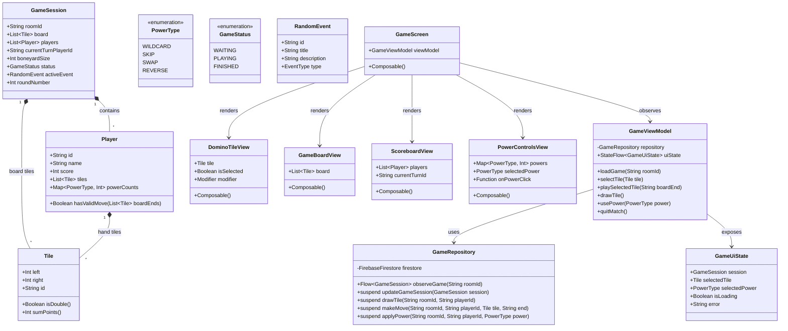

# Diagrama de Clases - GODSMINO

A continuación se presenta el diagrama de clases estructural del sistema GODSMINO utilizando notación **Mermaid**, cumpliendo con los requerimientos de arquitectura MVVM y componentes.

---

## Explicación de Relaciones Principales
1. **Composición (`*--`)**: Una `GameSession` contiene múltiples `Player` y `Tile` (tanto en el tablero como en el pozo). Cada `Player` contiene una lista de fichas (`Tile`) en su mano.
2. **Dependencia (`-->`)**: El `GameViewModel` interactúa con el `GameRepository` para sincronizar y persistir el estado de la partida en Firebase.
3. **Observación**: La vista (`GameScreen` y sus componentes reutilizables) observa el `StateFlow<GameUiState>` expuesto por el `GameViewModel`.
